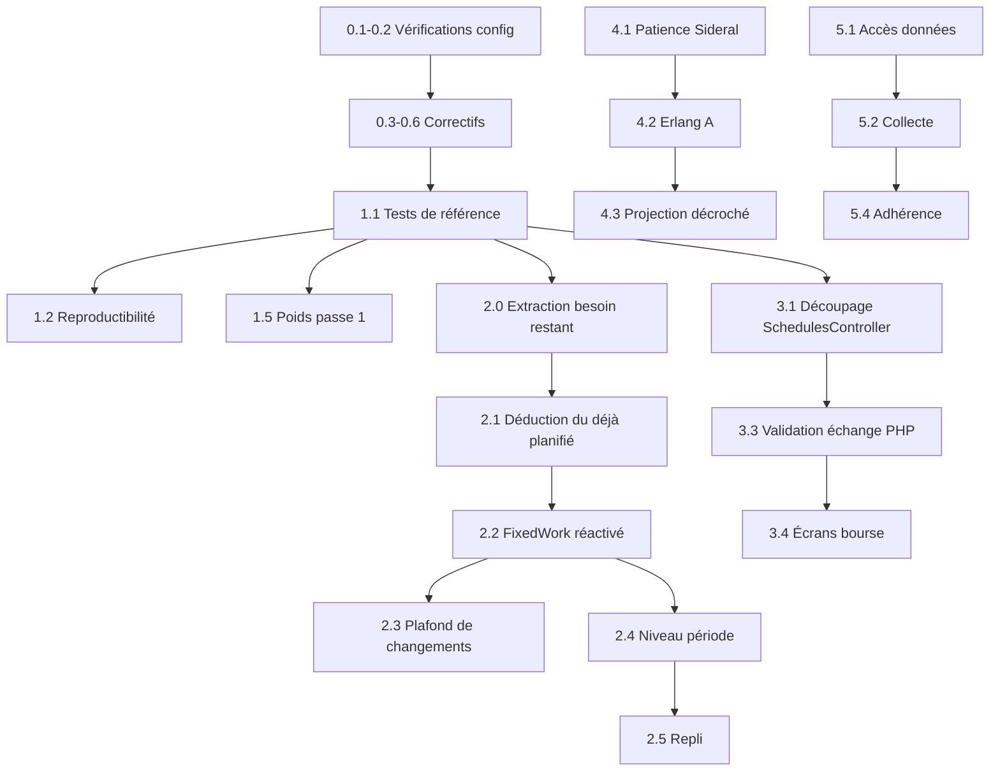

# Plan de route Shifti

_Créé le 18/11/2026 — dérivé de `docs/diagnostic-shifti-vs-editeurs-wfm.md`._

## Principes de priorisation

1. **Corriger ce qui fausse les plannings actuels** avant d'ajouter des fonctions.
2. **Sécuriser avant de modifier** : créer des tests de référence avant de toucher aux poids des solveurs.
3. **Livrer les fonctions obligatoires** (bourse d'échange) avant les fonctions utiles (adhérence).
4. **Regrouper les chantiers qui partagent une brique** (re-génération partielle et équité sur la période reposent toutes deux sur le travail imposé `FixedWork`).

Échelle d'effort : **S** = moins d'une journée, **M** = quelques jours, **L** = une à deux semaines, **XL** = plus.

---

## Phase 0 — Avant les présentations éditeurs

Objectif : corriger les défauts qui faussent les résultats, sans changer le comportement global. Durée estimée : 1 à 2 jours.

Ordre d'exécution : d'abord les vérifications de configuration (aucun code, gain immédiat), ensuite les correctifs.

| # | Action | Fichiers | Effort | Remarque |
|---|---|---|---|---|
| 0.1 | Vérifier le mode du groupe CESU / PAJEMPLOI | Configuration (écran Groupes d'offres, `forecast_source`) | S | Le mode « members » surestime le besoin. Attendu : mode « group ». |
| 0.2 | Vérifier l'offre des blocs de rotation GRC TI-AE | Configuration (règles de rotation) | S | Un bloc posé sur le mixte « TI-AE » ne déduit rien du besoin. Attendu : blocs sur « AE » ou « TI ». |
| 0.3 | Remettre la couverture devant la rotation des jours, avec **comparaison avant / après** | `solver-python/routers/solver_rotation.py` (l.483-501, relire aussi l.915) | S | Bug d'ordre des priorités : la pénalité « jour répété » (100) l'emporte sur un manque de 4 à 5 agents. Modifie l'emplacement de toutes les plages GRC : générer une semaine réelle avant la correction, la conserver, régénérer après, comparer couverture, nombre de plages par GRC et jours répétés. |
| 0.4 | Supprimer le plancher `max(..., 120)` sur `W_EQUITY` | `solver-python/routers/solver_coverage.py` (l.1375) | S | Une ligne. Rend le paramètre `weight_equity` réellement réglable. |
| 0.5 | Retirer ou implémenter `weight_break_alignment` | `solver-python/models/data_models.py`, écran de paramétrage | S | Paramètre visible mais ignoré par le solveur. |
| 0.6 | Documenter les arbitrages de poids de la passe 1 | `solver-python/routers/solver_fixed.py` (l.725-787), doc | S | Documenter, **ne pas rééquilibrer** à ce stade. |

---

## Phase 1 — Fiabilisation (socle des chantiers suivants)

Objectif : pouvoir modifier les solveurs sans régression et expliquer chaque résultat.

| # | Action | Fichiers | Effort | Dépend de |
|---|---|---|---|---|
| 1.1 | Tests de référence des solveurs : jeux de données réels anonymisés, valeurs d'objectif et indicateurs attendus (couverture, équité) | `solver-python/tests/` | M | — |
| 1.2 | Reproductibilité : `interleave_search = True`, `max_deterministic_time`, `num_workers` à la place de `num_search_workers` (déprécié). **Étalonner** `max_deterministic_time` sur le serveur de production (compteur de travail interne, proche de secondes mais pas égal). **Garder** `max_time_in_seconds` comme garde-fou (par exemple le double du temps habituel) ; s'il se déclenche, le résultat n'est plus reproductible : le **signaler** dans le rapport de génération | `solver_coverage.py`, `solver_fixed.py`, `solver_rotation.py` | S | 1.1 |
| 1.3 | Retourner l'écart à l'optimum (`BestObjectiveBound`) avec chaque résultat et l'afficher | `solver_coverage.py`, contrôleurs de génération | S | — |
| 1.4 | Sécuriser le microservice : jeton partagé vérifié par FastAPI, pas d'écoute sur `0.0.0.0` ni de `reload=True` en production | `solver-python/main.py`, services PHP appelant le solveur | S | — |
| 1.5 | Rééquilibrer les poids de la passe 1 (unités homogènes, hiérarchie explicite, éventuellement lexicographique comme la passe 2) | `solver_fixed.py` | M | 1.1, 0.6 |

---

## Phase 2 — Planification : re-génération partielle et équité sur la période

Objectif : supprimer les corrections manuelles et permettre les ajustements sous contrainte sociale. Les deux chantiers partagent la même brique (attributions imposées via `FixedWork`).

| # | Action | Fichiers | Effort | Dépend de |
|---|---|---|---|---|
| 2.0 | Extraire de `ScheduleDayGenerationService.php` (106 Ko) le calcul du besoin restant (`residualNeedCurve`, l.1225-1298) et la construction de la requête de passe 2 dans des classes dédiées. Découpage limité aux parties touchées par 2.1, 2.2 et 2.6 | `src/Service/ScheduleDayGenerationService.php`, nouvelles classes `src/Service/Generation/` | M | 1.1 |
| 2.1 | Déduire du besoin le déjà planifié des agents **non sélectionnés** lors d'une re-génération ciblée | classe extraite en 2.0 | M | 2.0 |
| 2.2 | Réactiver le travail imposé (`FixedWork`) dans le solveur de couverture : figer le passé, les semaines publiées, les attributions venues du niveau période | `solver_coverage.py`, `ScheduleDayGenerationService.php` (l.1350) | M | 2.1 |
| 2.3 | Plafond de changements d'offre par rapport au planning publié (1 à 2 par agent et par jour), interdiction ou forte pénalité back-office → téléphone | `solver_coverage.py`, paramétrage `WfmSettings` | M | 2.2 |
| 2.4 | Niveau période pour les activités fixes : nouvel endpoint (ex. `/solve-fixed-period`), cible à une plage près, lissage hebdomadaire (écart ≤ 1 plage entre semaines), min-max de l'écart à la cible. **Coût de tension par compétence**, en critère secondaire après l'équité : coût par agent et par demi-journée selon la tension prévue sur ses offres (exemple : éviter de retirer le seul expert CESU un jour de pic CESU). Ce coût choisit **qui** prend la plage, pas **si** elle a lieu : les plages d'accueil à horaires fixes sont dues chaque jour | nouveau routeur Python, `PlanningGenerationJobsController.php`, calcul des cibles existant, courbe de besoin | L | 2.2 |
| 2.5 | Règle de repli quand une attribution période devient impossible dans la journée (alerte + proposition d'un autre agent) | `ScheduleDayGenerationService.php`, écran qualité | M | 2.4 |
| 2.6 | Préserver l'équité lors des re-générations : l'historique transmis inclut le déjà planifié figé | classe extraite en 2.0, `JobPeriodEquityScoresProvider` | S | 2.1 |

Événements imprévisibles (grève, pic exceptionnel) : traités par la re-génération partielle (2.2, 2.3), pas par le niveau période, qui ne s'appuie que sur la prévision.

---

## Phase 3 — Bourse d'échange (obligatoire)

| # | Action | Fichiers | Effort | Dépend de |
|---|---|---|---|---|
| 3.1 | Découper `SchedulesController.php` (159 Ko) : extraire les services de lecture / écriture des plannings | `src/Controller/SchedulesController.php`, nouveaux services | L | 1.1 |
| 3.2 | Modèle de données : demandes d'échange (proposé, accepté, validé, refusé), migration | `config/Migrations`, `src/Model` | S | — |
| 3.3 | Validation en PHP : compétences des deux agents, bornes horaires, télétravail, activités fixes, couverture par offre non dégradée sur les créneaux échangés. Messages clairs | nouveau service `src/Service/Exchange/` | M | 3.1, 3.2 |
| 3.4 | Écrans agent et manager, circuit de validation, notifications (e-mail / application) | contrôleur, templates, policies | M | 3.3 |
| 3.5 | (Optionnel) Contrôle a posteriori par le solveur en tâche de fond, avec traduction des règles violées en messages lisibles | worker, `solver_coverage.py` | M | 2.2, 3.3 |

---

## Phase 4 — Prévision

| # | Action | Fichiers | Effort | Dépend de |
|---|---|---|---|---|
| 4.1 | Extraire de Sideral, par offre : appels abandonnés et temps d'attente total de **tous** les appelants → patience moyenne | import / `HistoricalDataController` | S | — |
| 4.2 | Erlang A : calcul par récurrence, précautions numériques (logarithmes), tests sur valeurs publiées | `src/Service/WfmCalculatorService.php` | M | 4.1 |
| 4.3 | Projection du taux de décroché selon le planning (sortie naturelle d'Erlang A) | `WfmCalculatorService.php`, écran planning | M | 4.2 |
| 4.4 | Comparaison besoin calculé / agents réellement au téléphone / qualité de service sur quelques semaines | export ou écran d'analyse | S | — |
| 4.5 | Groupe « COS » à 3 membres (ACCUR, AE, TI) ou groupes imbriqués, avant la bascule des profils COS | `OfferGroupsNeedService.php`, `solver_coverage.py` | M | 1.1 |
| 4.6 | Estimer le ratio AE / TI : demander à l'équipe téléphonie si les files virtuelles derrière le VoiceBot existent encore dans Genesys | hors code | S | — |

---

## Phase 5 — Données temps réel (si accès accordé)

| # | Action | Fichiers | Effort | Dépend de |
|---|---|---|---|---|
| 5.1 | Obtenir l'accès aux états agents (déjà consommés par Genesys WFM 8.5.2) et aux statistiques intra-jour | hors code | — | — |
| 5.2 | Collecte périodique (1 à 5 min) via le worker existant, stockage | nouvelle commande, migrations | M | 5.1 |
| 5.3 | Comparaison flux réel / prévision dans la journée, projection du décroché en fin de journée | service + écran | M | 5.2, 4.3 |
| 5.4 | Adhérence (planning publié vs états réels) | service + écran | M | 5.2 |

Hors périmètre : supervision temps réel (Pulse), application mobile, paie et annualisation.

---

## Dette technique continue

À traiter au fil des chantiers, sur les fichiers touchés :

- remplacer `Cake\I18n\FrozenDate` / `FrozenTime` (dépréciés en CakePHP 5, 46 fichiers) par `Cake\I18n\Date` / `Cake\I18n\DateTime` ;
- migrer les modèles Pydantic de `class Config` vers `model_config = ConfigDict(...)` ;
- poursuivre le découpage de `ScheduleDayGenerationService.php` (106 Ko, amorcé en 2.0) et découper `PlanningGenerationJobsController.php` (105 Ko).

---

## Vue d'ensemble des dépendances

